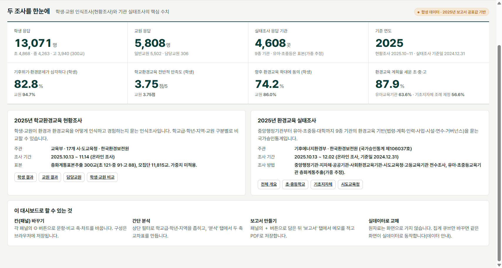
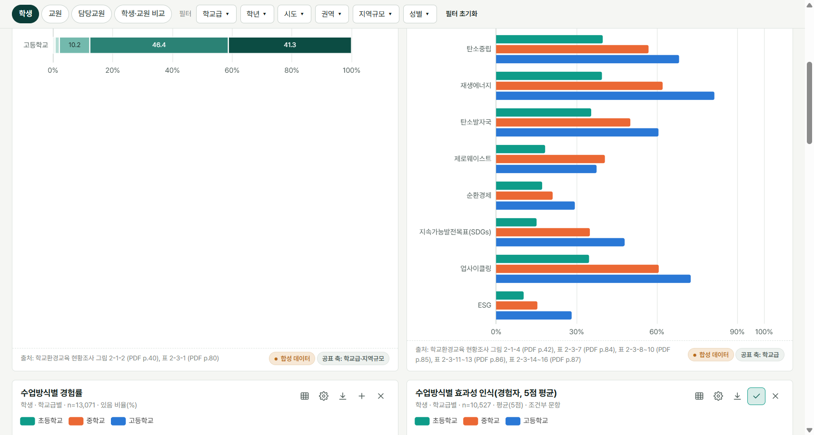
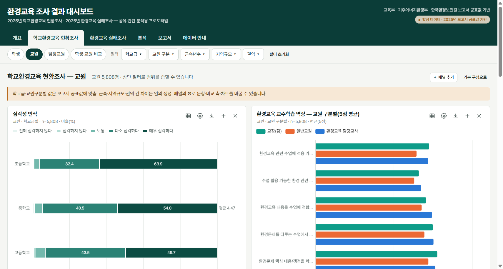
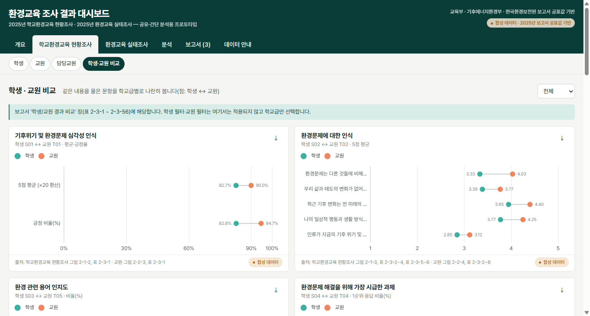
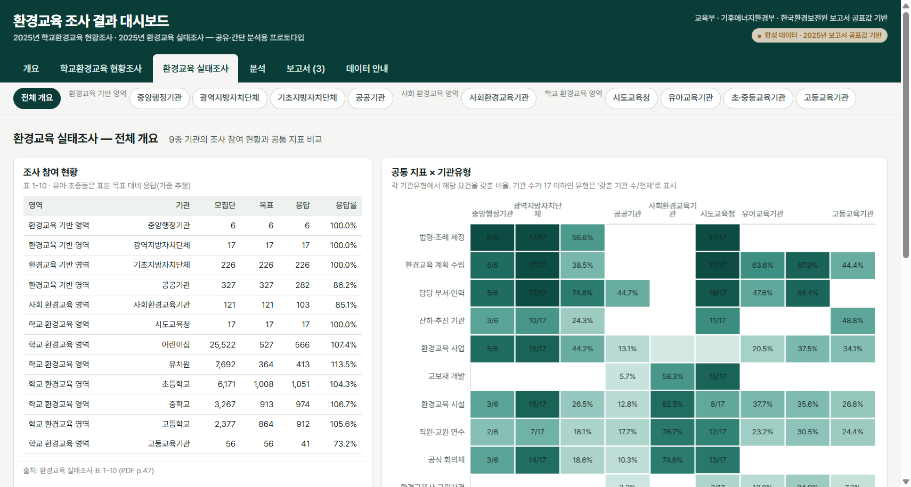
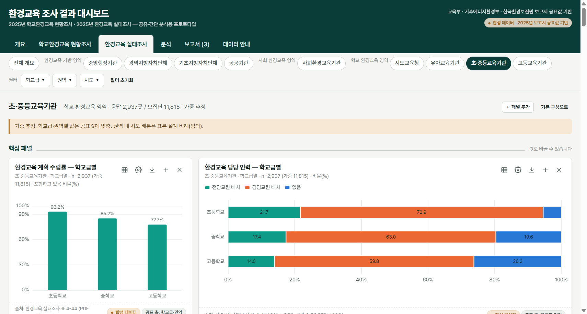
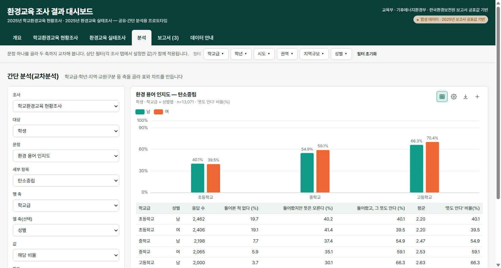
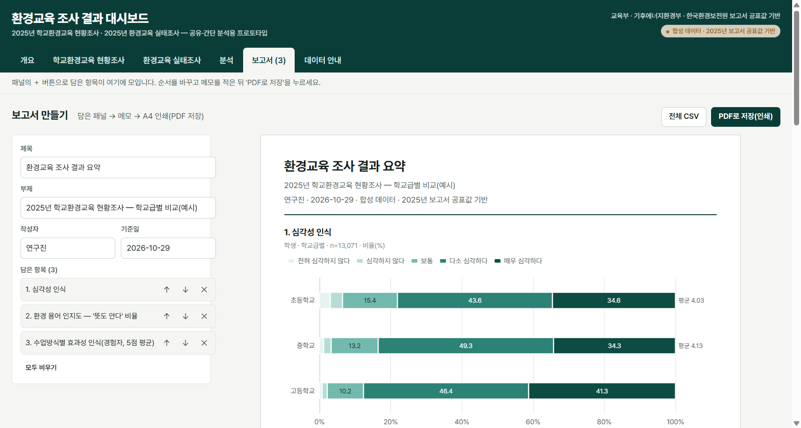
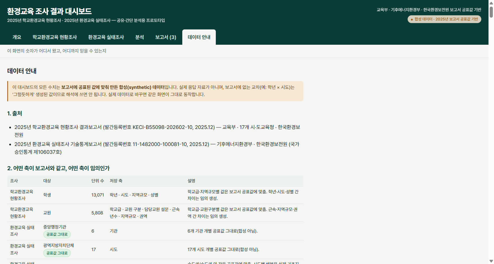
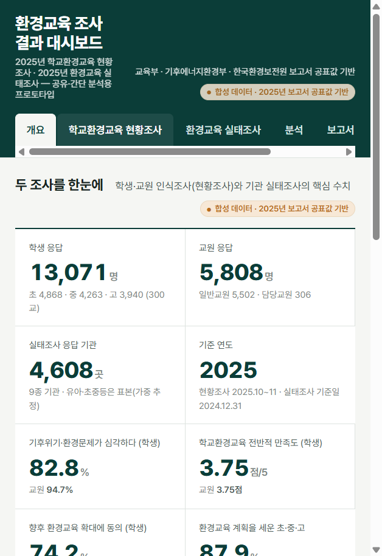

# 환경교육 조사 결과 대시보드 — 그림으로 보는 설명서

배포 주소: **https://raph-alpaca.github.io/eco-dashboard/** · 영상: `docs/video/대시보드_안내영상.mp4` · 팜플렛: `docs/pamphlet/대시보드_소개_팜플렛.pdf`

## 1. 개요 탭 — 두 조사를 한눈에

학생·교원 응답 수, 실태조사 응답 기관 수, 심각성 인식·만족도·확대 동의율, 초중등 계획 수립률 같은 핵심 수치를 장부처럼 보여줍니다. 아래 카드의 버튼으로 각 화면으로 이동합니다.

## 2. 학교환경교육 현황조사 — 학생 / 교원 / 담당교원

- 상단 **필터**(학교급·학년·시도·권역·지역규모·성별)로 범위를 좁히면 모든 패널이 함께 바뀝니다.
- 각 패널 오른쪽 위 버튼: ⊞ 표 보기 · ⚙ 지표 변경 · ⤓ 다운로드(CSV/PNG) · ＋ 보고서에 담기 · ✕ 제거.
- 패널 아래 "공표 축" 배지는 그 문항에서 보고서에 실제로 공표된 축입니다. 그 축의 값은 보고서와 같고, 다른 축의 차이는 합성(임의)입니다.

## 3. 학생·교원 비교

같은 내용을 물은 문항 14쌍을 덤벨 차트로 나란히 봅니다(점: 학생 ↔ 교원). 오른쪽 위에서 학교급을 고릅니다.

## 4. 환경교육 실태조사 — 전체 개요와 9종 기관

조사 참여 현황표, 공통 지표(법령·계획·인력·사업·시설·연수·회의체 등) × 9종 기관 히트맵, 지표를 골라 보는 17개 시도 타일맵.

기관유형 화면은 "핵심 패널"(⚙로 바꿀 수 있음)과 "전체 문항"(보고서의 모든 수치 표, 차트 버튼으로 전환)으로 구성됩니다.

## 5. 분석 — 간단 교차분석

조사 → 대상 → 문항 → 행 축 → 열 축(선택) → 값 → 차트를 고르고 '분석 실행'. 결과 패널은 표가 함께 열리며 CSV·PNG·보고서 담기가 됩니다.

## 6. 보고서 — 담은 패널을 PDF로

＋로 담은 패널이 모입니다. 제목·부제·작성자·기준일을 적고, 순서를 바꾸고, 그림마다 메모를 적은 뒤 **PDF로 저장(인쇄)** 을 누르면 A4로 인쇄(PDF 저장)됩니다. '전체 CSV'는 담은 패널의 수치를 한 파일로 내려받습니다.

## 7. 데이터 안내

수치의 출처, 어떤 축이 보고서와 같은지, 보고서 인쇄 오류 보정 메모, 실데이터로 바꾸는 3단계.

## 8. 휴대전화에서도

패널이 한 열로 쌓이고 필터는 접힙니다.

---
더 자세한 사용법: [dashboard-guide.md](dashboard-guide.md) · 데이터 규격: [data-spec.md](data-spec.md) · 홈페이지 연계: [integration-roadmap.md](integration-roadmap.md)
